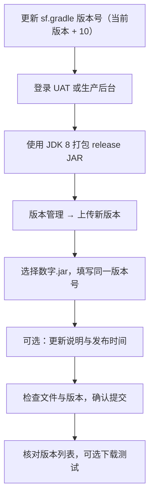

---
{"dg-publish":true,"dg-permalink":"sf-app-release","permalink":"/sf-app-release/","dg-note-properties":{"permalink":"/sf-app-release/","cssclasses":["wiki-page","wiki-article"]}}
---


[[index\|首页]] / [[04-移动端项目/tpm-evidence-audit-android\|证据审计 Android]] / App 发布

# SF直播App发布流程

用于 SF 直播 Android / RePlugin 在 UAT 和生产环境发版。每次先将数字版本号递增 10（例如 `100 → 110`），使用 JDK 8 生成 release JAR，再在对应后台上传并填写一致的数字版本号。

> [!wiki-nav] 本页导航
> [[07-运维与发布/发布流程/SF直播App发布流程#一图流程\|流程速览]] · [[07-运维与发布/发布流程/SF直播App发布流程#环境账号信息\|环境账号]] · [[07-运维与发布/发布流程/SF直播App发布流程#发布流程\|发版步骤]] · [[07-运维与发布/发布流程/SF直播App发布流程#常见问题\|问题处理]] · [[07-运维与发布/发布流程/SF直播App发布流程#发布检查清单\|检查清单]]

---

## 环境账号信息

### 生产环境（Production）

**访问地址：**
```
https://sf-banq.jncapp.cn/banquet/
```


---

### UAT 环境（User Acceptance Testing）

**访问地址：**
```
https://sf-uat.jncapp.com/banquet/login/index
```

**登录账号：**
- 账号：`test`
- 密码：`Fyp@134679`

---

## App 下载地址

> [!info] SF 直播 App 下载
> - Dev：<https://wine-eps-taibai-core-guian-guian1-oss.sit.sf-express.com/v1.2/AUTH_wine-EPS-TAIBAI-CORE/sfosspublic001/jnc_new_dev.apk>
> - Prod：<https://www.pgyer.com/WS3w8i>
> - 密码：`jnc123456`

---

## 发布流程

### 步骤 0：修改版本号（发版前必做）

**重要：** 每次顺丰发版前必须先修改 Android 项目的版本号，数字版本号每次x **10**。例如当前版本为 `10`，下次发布为 `100`。

**文件位置：**
```
<工作区>/tpm-evidence-audit-android/sf.gradle
```

**修改内容：**
```gradle
// 版本号配置（360 RePlugin）
build_versions.version_code = 13       // 版本代码（每次递增）
build_versions.version_name = "1.0.13" // 版本名称（与 JAR 包对应）
```

**版本号规则：**

| 项目               | 说明                  | 示例                 |
| ---------------- | ------------------- | ------------------ |
| **version_code** | 版本代码，纯数字，每次递增       | 10 → 11→ 12        |
| **version_name** | 版本名称，语义化版本          | "1.0.1" → "1.0.11" |
| **JAR 包名**       | 与 version_code 对应   | 10.jar、11.jar      |
| **提交 JAR**       | `version_code` x 10 | 100                |

**示例：**

**发布版本 110 时：**
```gradle
// 1. 修改 sf.gradle
build_versions.version_code = 11      // 从 10 改为 11
build_versions.version_name = "1.0.11" // 从 1.0.10 改为 1.0.11

// 2. 构建 JAR 包（会生成 11.jar）
// 3. 上传 11.jar 到后台
// 4. 填写版本号：110
```

`version_name` 通常使用“主版本.次版本.修订号”；数字版本递增和 JAR 命名关系以上表为准。

**检查清单：**
- [ ] 已修改 `build_versions.version_code`
- [ ] 已修改 `build_versions.version_name`
- [ ] 数字版本号 = 当前版本号 x 10（例如 10 → 100）
- [ ] 提交代码并打 Tag（可选）

```bash
# 提交版本号变更（可选）
git add versions.gradle
git commit -m "chore: bump version to 1.0.11"
git tag v1.0.11
git push origin master --tags
```

---

### 步骤 1：登录对应网页

**UAT 环境：**
1. 打开浏览器
2. 访问：https://sf-uat.jncapp.com/banquet/login/index
3. 输入账号：`test`
4. 输入密码：`Fyp@134679`
5. 点击登录

**生产环境：**
1. 打开浏览器
2. 访问：https://sf-banq.jncapp.cn/banquet/
3. 输入账号：`jncoperator`
4. 输入密码：`Fyp@134679`
5. 点击登录

---

### 步骤 2：准备发布包

**打包命令（Android/RePlugin）：**
```bash
cd "${WORK_ROOT:?请先设置 WORK_ROOT}/tpm-evidence-audit-android"
JAVA_HOME="${JAVA_HOME:?请先配置 JDK 8 的 JAVA_HOME}" ./gradlew :app:assembleRelease
```

**打包产物：**
```
app/build/outputs/apk/release/${version_code}.jar

示例：
app/build/outputs/apk/release/130.jar
```

**命令约定：**
- 必须使用 JDK 8；当前可用路径为 `corretto-1.8.0_412`。
- 不要用默认 JDK 20 打包，旧 Gradle/Javac 会触发 `IllegalAccessError`。
- Release 输出名由 `app/build.gradle` 的 `outputFileName = "${defaultConfig.versionCode}.jar"` 控制。

**文件命名规则：**
```
版本号.jar

示例：
10.jar    # 版本 100
11.jar    # 版本 110
12.jar    # 版本 120
13.jar    # 版本 130
```

上传文件必须使用 `app/build/outputs/apk/release/` 下的 release 产物，命名与版本号对应关系见 [[07-运维与发布/发布流程/SF直播App发布流程#步骤 0：修改版本号（发版前必做）\|#步骤 0：修改版本号（发版前必做）]]。

**示例：**
```bash
# 正确的命名
10.jar  # 正确
11.jar  # 正确
12.jar  # 正确

# 错误的命名
v100.jar      # 错误：不能有字母前缀
100.0.jar     # 错误：不能有小数点
app-100.jar   # 错误：不能有其他字符
```

---

### 步骤 3：上传并填写版本号

**操作流程：**

1. **找到上传入口**
   - 在后台管理界面
   - 找到【版本管理】或【应用管理】菜单
   - 点击【上传新版本】按钮

2. **上传文件**
   - 点击【选择文件】或拖拽文件
   - 选择准备好的 `.jar` 文件（如 `10.jar`）
   - 等待上传完成

3. **填写版本信息**
   - **版本号**：填写数字（如 `100`）
   - **更新说明**（可选）：填写本次更新内容
   - **发布时间**（可选）：选择立即发布或定时发布

4. **确认发布**
   - 检查版本号是否正确
   - 检查文件是否上传成功
   - 点击【确认】或【提交】按钮

---

## 完整操作示例

### UAT 环境发布示例

```
1. 登录 UAT 环境
   https://sf-uat.jncapp.com/banquet/login/index
   账号：test
   密码：Fyp@134679

2. 准备发布包
   文件名：100.jar
   
3. 上传操作
   - 进入【版本管理】
   - 点击【上传新版本】
   - 选择文件：100.jar
   - 填写版本号：100
   - 填写更新说明：修复已知问题
   - 点击【确认】

4. 验证
   - 查看版本列表
   - 确认版本 100 已上传
   - 下载测试（可选）
```

---

### 生产环境发布示例

```
1. 登录生产环境
   https://sf-banq.jncapp.cn/banquet/
   账号：jncoperator
   密码：Fyp@134679

2. 准备发布包
   文件名：110.jar
   
3. 上传操作
   - 进入【版本管理】
   - 点击【上传新版本】
   - 选择文件：110.jar
   - 填写版本号：110
   - 填写更新说明：新增直播美颜功能
   - 点击【确认】

4. 发布后检查
   - 查看版本列表
   - 确认版本 110 已上传
   - 监控用户反馈
```

---

## 版本号管理规则

### 版本号递增规则

顺丰发版的数字版本号每次递增 **10**，UAT 和生产环境均按对应环境的当前版本计算：

```text
下次发布版本号 = 当前版本号 + 10
100 → 110 → 120 → 130 ...
```

**示例：**
```text
当前版本：100
  下次发布版本号：110
  发布包：110.jar
  后台填写版本号：110
```

`x10` 表示每次加 10，不是将当前版本乘以 10。`build_versions.version_code`、JAR 文件名和后台填写的版本号必须一致。

### 查看当前版本号

1. 登录对应环境的网页
2. 进入【版本管理】
3. 查看【当前版本】或【版本列表】
4. 找到最新的版本号
5. 下次发布时版本号 = 最新版本号 + 10（例如 100 → 110）

---

## 常见问题

### 问题 1：版本号填错了

**现象：**
上传了 `110.jar`，但填写版本号时填成了 `100`

**影响：**
- 文件名和版本号不匹配
- 可能导致下载错误

**解决方案：**
```
1. 删除刚上传的版本
2. 重新上传，填写正确的版本号（110）

或者

1. 重命名文件为 100.jar
2. 重新上传
```

---

### 问题 2：文件格式错误

**现象：**
上传 `.apk` 或 `.zip` 文件，提示格式错误

**解决方案：**
```
确保文件是 .jar 格式
如果是 APK 文件，需要先转换成 JAR 格式
（具体转换方式咨询开发团队）
```

---

### 问题 3：版本号没有递增

**现象：**
上传 `10.jar`，但当前已经是版本 100

**解决方案：**
```
1. 查看当前最新版本号
2. 确保新版本号 = 当前版本号 + 10
3. 重新命名文件（如 110.jar）
4. 重新上传
```

---

### 问题 4：忘记登录账号密码

**解决方案：**

**UAT 环境：**
- 网址：https://sf-uat.jncapp.com/banquet/login/index
- 账号：test
- 密码：Fyp@134679

**生产环境：**
- 网址：https://sf-banq.jncapp.cn/banquet/
- 账号：jncoperator
- 密码：Fyp@134679

**或者查看本文档顶部的【环境账号信息】**

---

## 发布检查清单

### 发布前检查

- [ ] **已修改版本号**（sf.gradle）
  - [ ] `build_versions.version_code` = 当前版本号 + 10
  - [ ] `build_versions.version_name` 已更新
- [ ] 确认要发布的环境（UAT 或生产）
- [ ] 查看后台当前最新版本号
- [ ] 使用 JDK 8 执行 `./gradlew :app:assembleRelease`
- [ ] 准备 `.jar` 文件：`app/build/outputs/apk/release/${version_code}.jar`
- [ ] 文件命名正确（纯数字.jar）
- [ ] JAR 包版本号与 `version_code` 一致

### 上传时检查

- [ ] 登录账号正确
- [ ] 选择文件正确
- [ ] 填写版本号正确（与文件名一致）
- [ ] 填写更新说明（可选）

### 发布后检查

- [ ] 版本列表中显示新版本
- [ ] 版本号正确
- [ ] 可以下载测试（可选）

---

## 快速参考

### 一图流程



版本示例：`version_code = 120 → 130`、`version_name = "1.0.120" → "1.0.130"`；`plugin_version = version_code`，最终上传 `130.jar`、填写 `130`。完整打包命令与产物路径见 [[07-运维与发布/发布流程/SF直播App发布流程#步骤 2：准备发布包\|#步骤 2：准备发布包]]。

### 环境对照表

| 环境 | 网址 | 账号 | 密码 | 文件格式 |
|------|------|------|------|---------|
| UAT | https://sf-uat.jncapp.com/banquet/login/index | test | Fyp@134679 | 版本号.jar |
| 生产 | https://sf-banq.jncapp.cn/banquet/ | jncoperator | Fyp@134679 | 版本号.jar |

---

## 相关文档

- [[07-运维与发布/通用/Jenkins部署规则\|Jenkins部署规则]] - Jenkins 发布规则
- [[08-知识库指南/优化工作流程指南\|优化工作流程指南]] - 日常工作流程
- [[09-问题与记录/问题记录\|问题记录]] - 问题记录

---

## 标签

#SF直播 #直播App #发布流程 #UAT #生产环境 #版本管理 #JAR包

---

**记录时间：** 2026-06-16  
**记录人：** dompling  
**最后更新：** 2026-10-14
